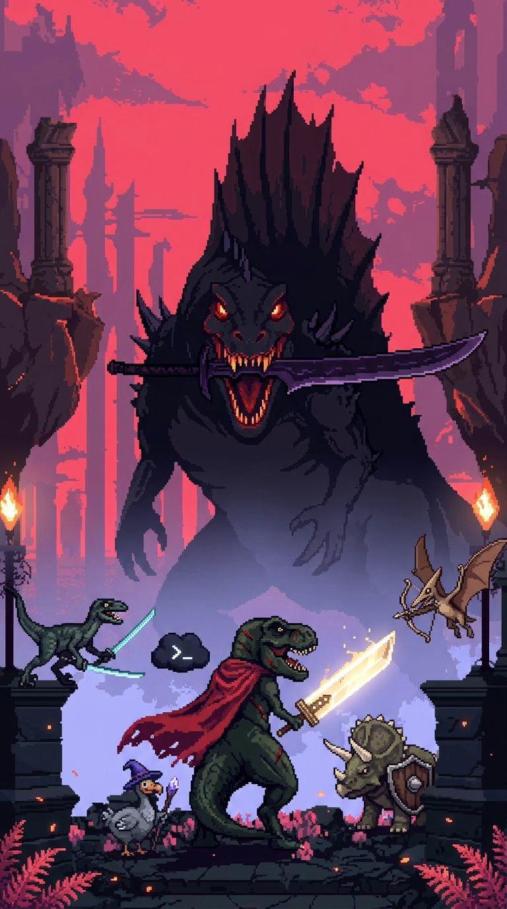
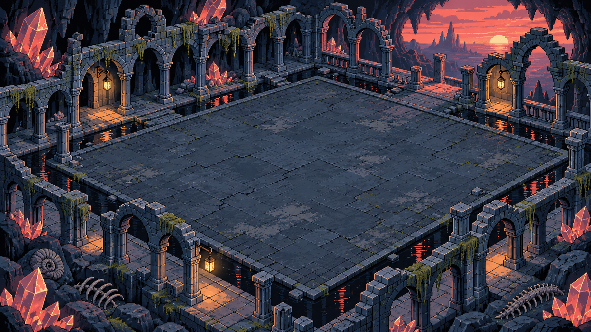
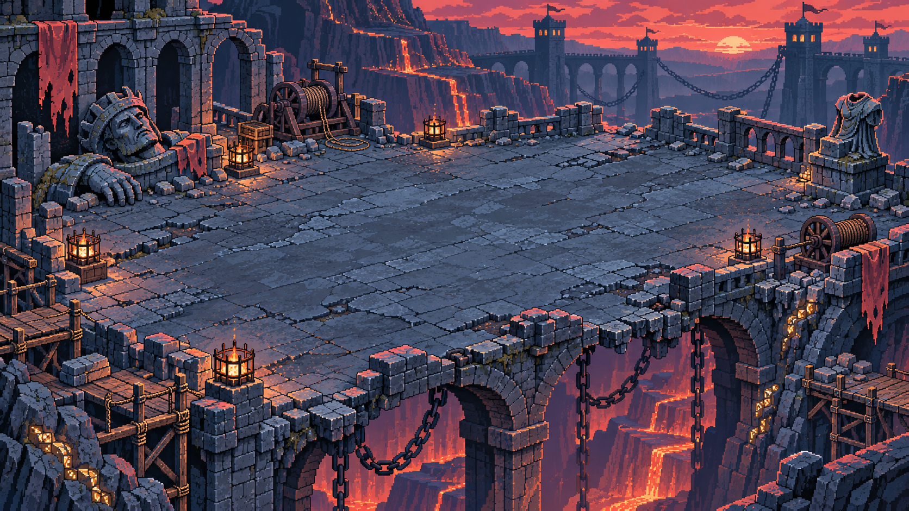
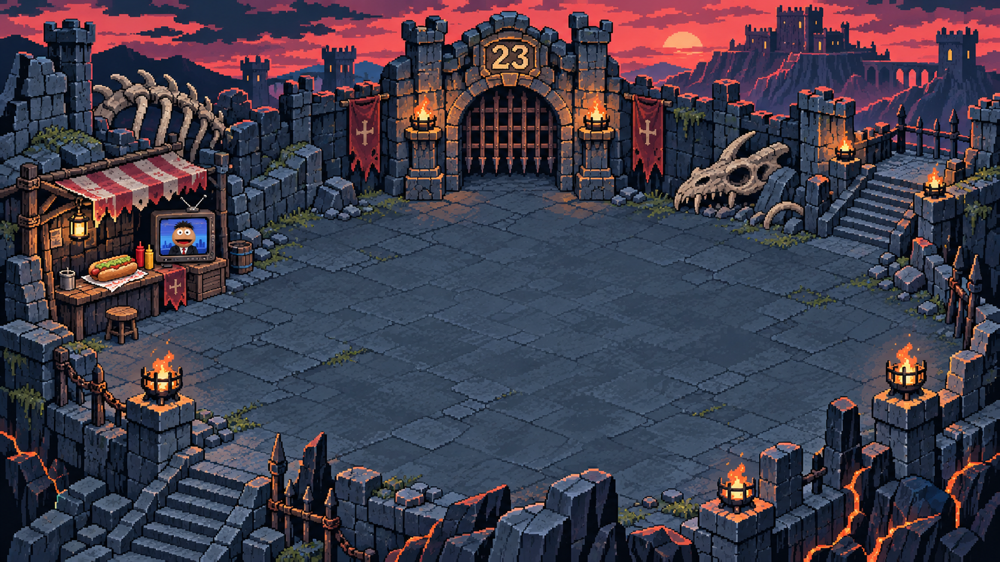
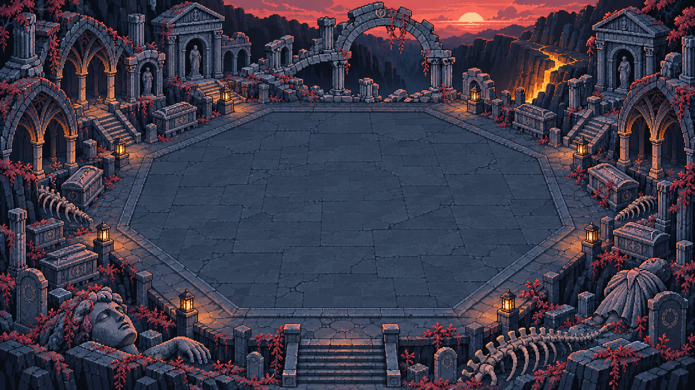

<div align="center">



# 🦖 DinoLike: Reino Jurásico
🏆 **Proyecto creado para el Hackatón de OpenAI.**
DinoLike: Reino Jurásico es un action roguelite isométrico en pixel art con 5 dinosaurios jugables, 4 escenarios, jefes con fases y audio procedural. Lo construimos en pocos días combinando diseño de juego dirigido por datos (JSON + Zod), un motor de combate puro y testeable, y arte y cinemáticas generados con IA

**Action roguelite 2D isométrico en pixel art, donde los dinosaurios cargan armas legendarias.**


[Jugar](#-inicio-rápido) · [Dinosaurios](#-elige-tu-dinosaurio) · [Escenarios](#-escenarios-de-falla-23) · [Controles](#-controles) · [Arquitectura](#-arquitectura) · [Docs](#-documentación)

</div>

---

## ✨ El juego

Desciende por la **Falla 23**, un reino en ruinas flotando sobre un cielo carmesí. Elige una especie, aguanta oleadas de criaturas, junta **reliquias** y **bendiciones** y enfrenta al coloso que espera en el Osario Hundido: el **Espinosaurio**.

- ⚔️ **5 clases jugables**, cada una con arma, pasiva y 3 habilidades propias.
- 🔥 **Sistema de elementos** (Magma, Hidro, Tempestad, Sísmico, Veneno) con ventajas y resistencias.
- 🗺️ **4 escenarios** con caminos, paleta dominante y arquitectura isométrica propia.
- 👹 **Jefes con fases**, oleadas escalables, reliquias, bendiciones y comida curativa.
- 🎬 **Cinemáticas de introducción** a pantalla completa para cada dinosaurio.
- 🔊 **Audio procedural** con Web Audio (SFX y música) y arte pixel art generado para el juego.

## 🦕 Elige tu dinosaurio

| Clase | Arma | Estilo |
| --- | --- | --- |
| 🦖 **T-Rex** | Espadón Gigante | Coloso de daño bruto. Tajos amplios y salto aplastante. *Ejecución Tiránica:* +25% de daño a enemigos bajo 45% de vida. |
| 🦎 **Velociraptor** | Katanas Dobles | Glass cannon ultrarrápido con dash cortante y críticos ×2. |
| 🐂 **Triceratops** | Escudo Óseo y Lanza | Tanque herbívoro acorazado con embestida y pisotón sísmico. |
| 🐦 **Dodo Mago** | Gorrito de Mago + Báculo de Ámbar | Mago elemental con magma, rayo jurásico y lluvia de meteoritos. |
| 🪽 **Pteranodon** | Arco de Hueso | Arquero ágil a distancia con flechas perforantes y lluvia de espinas. |

## 🗺️ Escenarios de Falla 23

Cada piso mezcla losas con rutas de otro material y un color dominante propio.

<table>
  <tr>
    <td align="center" width="50%">
      <br />
      <b>Piso 1 · Claustro Mineral</b><br />
      <sub>Jade y ámbar · isla central, foso y calzadas</sub>
    </td>
    <td align="center" width="50%">
      <br />
      <b>Piso 2 · Puente Quebrado</b><br />
      <sub>Violeta y cobre · pasarelas sobre un abismo de lava</sub>
    </td>
  </tr>
  <tr>
    <td align="center" width="50%">
      <br />
      <b>Piso 3 · Fortaleza Falla 23</b><br />
      <sub>Azul acero y coral · camino procesional hasta el portón «23»</sub>
    </td>
    <td align="center" width="50%">
      <br />
      <b>Piso 4 · Osario Hundido</b><br />
      <sub>Arena octogonal final del Espinosaurio</sub>
    </td>
  </tr>
</table>

> Los mockups son referencia visual. En el juego, la cuadrícula de `src/core/scenarioLayouts.ts` define el piso, el vacío, las paredes y los portales, y `src/game/mapRenderer.ts` los dibuja con losetas isométricas. Más detalle en [`docs/concept-art/escenarios`](./docs/concept-art/escenarios/README.md).

## 🎮 Controles

| Tecla / Entrada | Acción |
| --- | --- |
| `W A S D` / Flechas / Joystick táctil | Mover por el terreno isométrico |
| Automático / Click izquierdo | Ataque básico al enemigo cercano o habilidad hacia el cursor |
| `1` `2` `3` | Habilidades activas de la clase |
| `Q` | Poción de Ámbar (recupera HP y SP) |
| `C` | Panel de Estadísticas y Reliquias (pausa) |
| `R` | Activar / desactivar Auto-Cast |
| `M` | Silenciar / activar audio |
| `Esc` | Pausa / volver al título |

## 🚀 Inicio rápido

```bash
git clone <url-del-repo>
cd roguelike-fantasy-2d
npm install
npm run dev        # servidor de desarrollo (Vite)
```

| Comando | Qué hace |
| --- | --- |
| `npm run dev` | Servidor de desarrollo |
| `npm run build` | Type-check (`tsc --noEmit`) + bundle de producción |
| `npm test` | Tests unitarios y de validación de datos (Vitest) |
| `npm run lint` | ESLint sobre `src/` y `tests/` |
| `npm run sim -- --runs 50 --seed 42` | Simulación de balance headless de las 5 clases |
| `npm run remotion:studio` | Editar el video de la landing (Remotion) |
| `npm run remotion:render` | Renderizar `public/landing/dinolike-landing.mp4` |

## 🧱 Arquitectura

```
src/
├─ core/     Lógica pura (sin Phaser ni DOM): combate, stats, elementos, IA,
│            generación de mapas, reliquias, bendiciones y cast()
├─ data/     Contenido en JSON validado con Zod: clases, skills, mobs, mapas,
│            elementos, boons, reliquias y names.es.json (todos los textos)
├─ game/     Renderer Phaser 4.2.1: presentación, input, pools de texturas y audio
├─ assets/   Sprites y losetas pixel art + manifest.json
├─ audio/    SFX y BGM procedurales con Web Audio
└─ sim/      Simulador de balance headless
```

Principios:

1. **`src/core/` no importa `phaser` ni APIs del DOM**, así Vitest y el simulador corren sin navegador.
2. **El contenido es dato**: añadir un mob, skill o mapa es editar JSON validado con Zod.
3. **Cero textos hardcodeados**: todo nombre visible se referencia por `id` en `names.es.json`.
4. **Pixel art nítido** (`pixelArt: true`, `roundPixels: true`) con proyección isométrica 2:1 (`gridToScreen` / `screenToGrid`).

## 📚 Documentación

- [`docs/SPEC.md`](./docs/SPEC.md): especificación completa.
- [`docs/MVP.md`](./docs/MVP.md): alcance del primer MVP.
- [`docs/concept-art/escenarios/README.md`](./docs/concept-art/escenarios/README.md): escenarios y layouts.
- [`AGENTS.md`](./AGENTS.md): convenciones del repositorio.

## 📄 Licencia

[MIT](./LICENSE)
